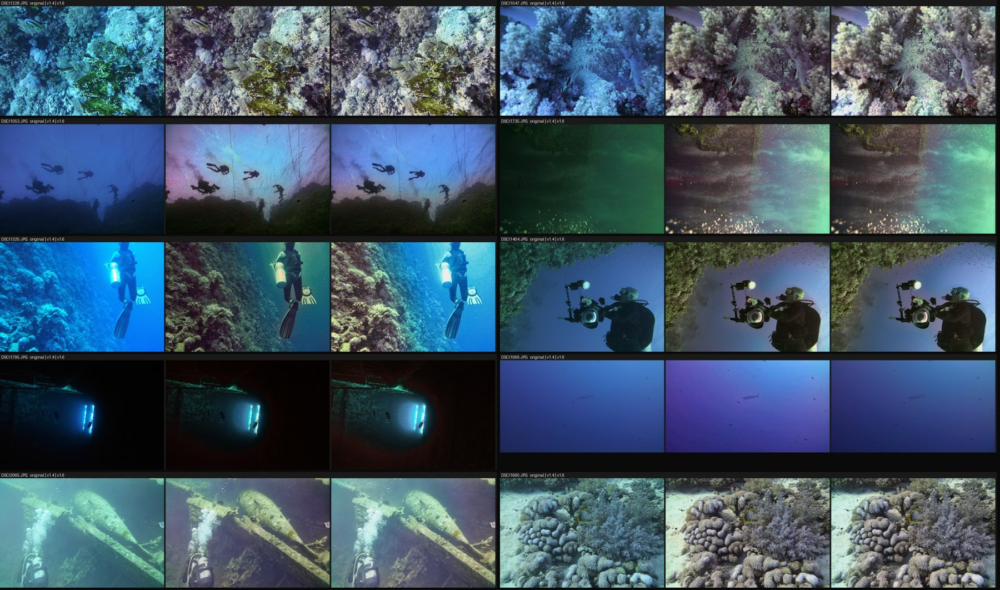
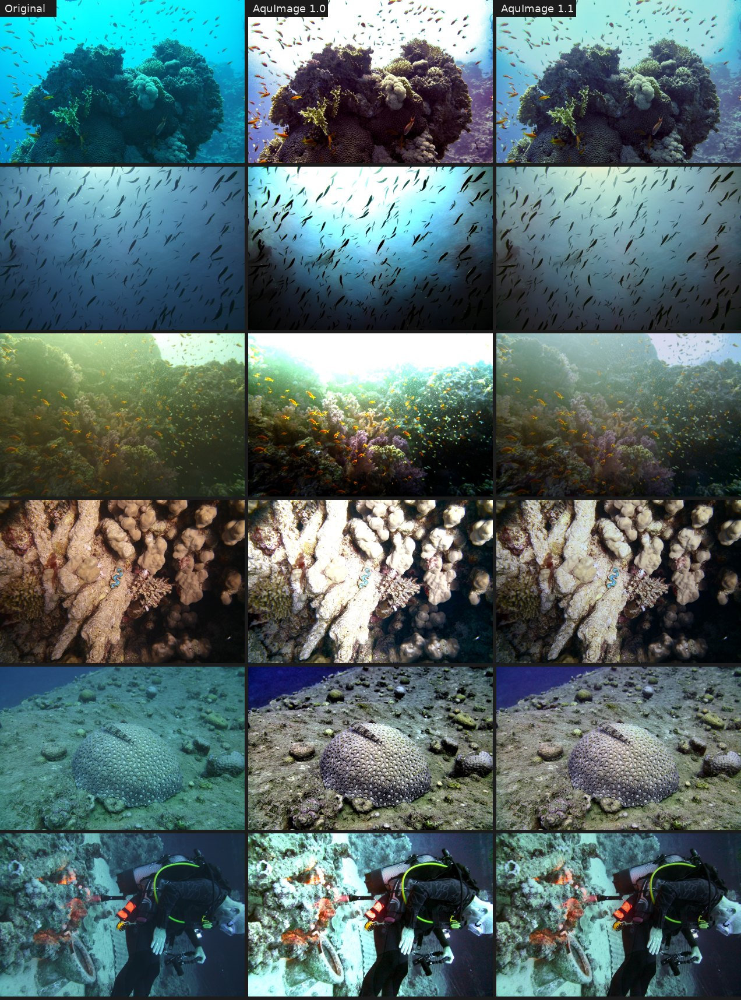

# AquImage

Correction automatique des photos et vidéos de plongée, pour usage personnel. Sans licence et sans connexion : tout tourne sur votre ordinateur.


## Démarrer

Double-cliquez sur **`AquImage.bat`**.

- Au premier lancement, le fichier crée un environnement Python dans `%LOCALAPPDATA%\AquImage\venv`, hors de OneDrive pour ne pas synchroniser des milliers de fichiers, puis installe les dépendances. Comptez quelques minutes.
- L'interface s'ouvre ensuite dans votre navigateur, à l'adresse `http://127.0.0.1:8765`. Elle ne fonctionne que sur cet ordinateur.
- Fermez la fenêtre noire pour quitter.

Python 3.9 ou plus récent est nécessaire. Le lanceur trouve `C:\Python\Python39`, sinon `py` ou `python`.

**Langue :** l'interface existe en français, anglais, espagnol et allemand. Choisissez-la en haut à droite ; le choix est mémorisé.

Pour corriger un dossier sans ouvrir l'interface, glissez-le sur **`Corriger un dossier.bat`**. Les fichiers corrigés vont dans un sous-dossier `AquImage` de ce dossier.

## Lot : toute une plongée d'un coup

1. Choisissez le dossier des originaux et celui des fichiers corrigés.
2. Cliquez sur **Corriger le dossier**.

Chaque photo et chaque vidéo reçoit **ses propres réglages**, estimés d'après sa dominante de couleur, son voile, son bruit et la couleur de l'eau. Les originaux ne sont jamais modifiés.

- **Sous-dossiers :** ils sont recréés à l'identique dans la destination.
- **Fichiers déjà corrigés :** ils sont ignorés, ce qui permet de relancer un lot interrompu. Cochez « Refaire » pour les recalculer.
- **Ajustements communs :** ils s'ajoutent aux réglages automatiques de chaque fichier, par exemple un peu plus chaud pour toute une plongée.
- **Réglages identiques pour tous :** cette option reprend les réglages faits dans l'atelier sur une photo.
- **Rapport :** `aquimage_rapport.csv` est écrit dans la destination. Il contient, pour chaque fichier, le type d'image détecté, les réglages retenus, la durée et les erreurs éventuelles. Il s'ouvre dans Excel.
- **Ouvrir le dossier de sortie :** ce bouton, à droite de la barre de progression, ouvre la destination dans l'Explorateur Windows.
- **Filtres :** pendant et après le lot, la liste se filtre par état (à traiter, corrigés, ignorés, erreurs) et par type (photos ou vidéos). Chaque bouton indique son nombre de fichiers.
- **Dossiers de sortie :** un dossier nommé `AquImage`, ou contenant un rapport, n'est jamais retraité.

## Atelier : une photo à la fois

- La colonne de gauche montre les photos et vidéos du dossier. Les flèches du clavier passent à la suivante.
- Faites glisser le séparateur orange pour comparer l'original et la photo corrigée. Maintenez **Espace** pour voir l'original en entier.
- La molette zoome et le glisser déplace l'image. Un double-clic ajuste l'image à la fenêtre.
- **Filtres de la colonne :** « À corriger » masque les fichiers qui ont déjà une version dans le dossier « Enregistrer dans » ; ceux-là portent une coche ✓. « Photos » et « Vidéos » filtrent par type. Les flèches du clavier ne parcourent que les fichiers affichés, et les filtres choisis sont mémorisés.
- **Rotation :** les boutons ↺ ↻ sous l'image, ou les touches **R** (sens horaire) et **Maj+R** (sens inverse), tournent la photo ou la vidéo par quarts de tour. La rotation est appliquée au fichier enregistré ou à la vidéo exportée. Elle repart de zéro à chaque nouvelle photo et ne s'applique pas au lot.
- Les curseurs partent des valeurs automatiques. Un double-clic sur un nom de curseur le ramène à sa valeur automatique.
- **L'aperçu est fidèle à l'export :** les réglages ne dépendent pas de la résolution. L'écart mesuré entre l'aperçu et l'export pleine résolution est de 0,85 niveau sur 255.
- **Enregistrer** produit le fichier en pleine résolution. Pour une vidéo, **Exporter la vidéo** traite le clip entier.
- **Ouvrir le dossier**, sous le message d'enregistrement, ouvre l'Explorateur avec le fichier corrigé sélectionné.

| Curseur | Effet |
| --- | --- |
| Compensation du rouge | Reconstruit le rouge absorbé par l'eau, là où le vert porte du signal |
| Correction de la dominante | Neutralise la teinte bleue ou verte globale |
| Bleu gardé dans l'eau lointaine | 0 rend l'eau du fond grise ; plus haut, elle reste bleue tandis que les sujets proches sont corrigés |
| Température, Teinte | Réglages créatifs, du froid au chaud et du vert au magenta |
| Retrait du voile | Enlève la brume de l'eau et rend du contraste aux sujets lointains |
| Protection contre le bruit au loin | Limite l'amplification du bruit dans les zones très voilées |
| Éclaircir les ombres | Débouche les sujets sombres (utile en contre-jour) |
| Contraste local | Clarté des détails, appliquée aux tons moyens seulement |
| Vibrance | Ravive les couleurs ternes sans pousser celles déjà vives |
| Luminosité, Saturation | Réglages de tonalité |

## Vidéos

- **Réglages stables :** ils sont estimés une fois par vidéo, sur 8 images clés, pour que la couleur ne scintille pas. Seul le voile est suivi image par image, avec un lissage dans le temps.
- **Encodage :** H.264 (CRF 21, débit plafonné à celui de la source) avec le son d'origine (converti en AAC) et la date de prise de vue. La sortie est toujours en `.mp4`.
- **Vitesse :** sur la machine de test (2 cœurs), un clip 1080p à 30 i/s se traite à environ 4 images par seconde. Un ordinateur à 8 cœurs ira nettement plus vite.

## Formats

| Entrée | Sortie |
| --- | --- |
| JPEG, PNG, TIFF, WebP, BMP | Même format, ou JPEG / TIFF / PNG au choix |
| PNG et TIFF 16 bits | 16 bits conservé |
| MP4, MOV, AVI, MKV, M4V, MTS | MP4 H.264 + AAC |

L'EXIF est conservé (appareil, date, réglages de prise de vue), tout comme le profil de couleur ICC. Une photo prise en portrait est redressée. Les chemins avec accents, comme « Plongée été », sont gérés.

Le RAW et le HEIC ne sont pas encore lus : convertissez-les d'abord en TIFF 16 bits ou en JPEG.

## Ligne de commande

```bat
AquImage.bat lot "D:\Plongées\Brut" "D:\Plongées\Corrigées"
AquImage.bat lot SOURCE DEST --format jpg --qualite 92 --ajuste temperature=0.2
AquImage.bat image entree.jpg sortie.jpg
AquImage.bat ui --port 8800
```

`AquImage.bat lot --help` liste toutes les options.

## Comment ça marche

AquImage estime tout sur une copie réduite d'environ 0,3 Mpx. Il applique ensuite le résultat à la pleine résolution, par bandes de lignes, ce qui borne la mémoire utilisée.

1. **Compensation des canaux affaiblis.** Méthode d'Ancuti et al. (2018) : R' = R + (Ḡ − R̄)(1 − R)·G. Le bleu est compensé de la même façon en eau verte.
2. **Balance des blancs.** Méthode « gray-world » en lumière linéaire, calculée surtout sur les sujets proches pour que l'eau, souvent majoritaire, n'impose pas sa couleur.
3. **Retrait du voile.** Prior du canal sombre (He et al. 2011). La lumière de l'eau est cherchée par quadtree, dans une zone voilée et uniforme, pour ne pas confondre un objet clair avec l'eau. La transmission est affinée par filtre guidé. La soustraction est bornée pixel par pixel, ce qui évite les ombres violettes.
4. **Correction graduée.** Elle est pleine sur les sujets proches et partielle sur l'eau très lointaine, qui reste bleue au lieu de virer au gris ou au magenta. La part gardée est choisie automatiquement en testant les pixels lointains.
5. **Tonalité, sans rien couper.** Niveaux à étirement limité (×2,5 au plus), gamma modéré, éclaircissement des ombres, vibrance, clarté sur les tons moyens. Enfin, une épaule douce compresse les hautes lumières vers le blanc sans les écrêter et sans changer leur teinte.

Ce que l'auto-réglage détecte, image par image :

| Cas détecté | Réglages appliqués |
| --- | --- |
| Vraie dominante sous-marine | Correction complète |
| Dominante légère | Correction modérée |
| Photo déjà équilibrée (flash, mode plongée de l'appareil) | Correction douce |
| Filtre rouge | Correction sans compensation du rouge |
| Contre-jour vers la surface | Voile moins retiré, ombres débouchées, ciel préservé |
| Pleine eau sans sujet, même en dégradé de lumière | Pas d'étirement (le bruit et le vignetage ne sont pas amplifiés), l'eau reste azur |
| Ombres virant au violet | Balance des blancs réduite automatiquement |

Quelle que soit la photo, quatre garde-fous s'appliquent aussi :
- **Eau lointaine :** elle garde sa teinte bleue. Seuls les sujets proches sont corrigés en entier, avec une transition douce entre les deux.
- **Couleur au loin :** elle suit une carte de distance lissée. Au loin, seule la luminance est restaurée : le plancton, les bulles et le bruit ne deviennent pas des taches roses ou vertes.
- **Ombres et quasi-noirs :** le magenta est retiré des ombres, et les quasi-noirs perdent leur teinte (plus de noirs bordeaux dans les épaves).
- **Luminosité :** une photo claire à l'origine n'est pas assombrie, et les reflets écrêtés (soleil) ne dictent plus l'exposition.

Le niveau de bruit règle aussi le retrait du voile, et le contraste obtenu règle la clarté. Ces règles ont été calibrées sur 35 photos réelles, puis validées sur 40 photos d'un voyage en mer Rouge (SeaLife DC2000), et sur 24 scènes simulées dont on connaît la vraie couleur.

**Limite connue :** les photos déjà roses (mode plongée de l'appareil trop poussé) ou jaunes au flash gardent une partie de leur dominante. Les curseurs Teinte et Température la corrigent.

## Historique

### 1.6.0

Suite de l'analyse des 1 045 photos du voyage Mer Rouge 2026 corrigées en 1.4. Mêmes photos, mêmes mesures, avant et après :

| Défaut (nombre de photos sur 1 045) | 1.4 | 1.6 | Original |
| --- | --- | --- | --- |
| Ombres pourpres ou magenta | 73 | 12 | 9 |
| Assombries de plus de 10 points | 43 | 3 | — |
| Assombries de plus de 5 points | 150 | 48 | — |
| Bruit doublé ou plus | 151 | 120 | — |
| Blancs écrêtés (plus de 1 %) | 0 | 0 | — |

Sur un échantillon de 40 photos, la part de pixels pourpres passe de 1,9 % à 0,2 % (0,06 % dans les originaux), et les taches de couleur dans l'eau lisse reculent d'environ 20 %.

- **Ombres pourpres :** le magenta est retiré des tons sombres, et les quasi-noirs perdent leur teinte bordeaux.
- **Eau bleue :** l'eau lointaine garde sa couleur. Les gains et la compensation suivent une carte de distance lissée, au lieu des marbrures de la carte fine.
- **Taches dans l'eau :** au loin, seule la luminance est restaurée, pour ne pas amplifier le plancton, les bulles et le bruit.
- **Assombrissement :**
  - l'exposition se règle sur les hautes lumières non écrêtées ;
  - l'auto-gamma n'assombrit plus nettement une photo claire.
- **Pleine eau :** elle est aussi détectée quand l'eau est en dégradé. Elle ne vire plus à l'indigo.



### 1.5.0

- **Ouvrir le dossier :** un bouton ouvre la destination du lot dans l'Explorateur Windows. Dans l'atelier, il sélectionne directement le fichier que vous venez d'enregistrer ou d'exporter.

### 1.4.0

- **Filtres dans le lot :** par état (tous, à traiter, corrigés, ignorés, erreurs) et par type (photos, vidéos), avec le nombre de fichiers sur chaque bouton.
- **Filtres dans la colonne de l'atelier :** « À corriger » (pas encore enregistrés dans le dossier de destination, les autres portent une coche ✓), photos ou vidéos. Les flèches ne parcourent que les fichiers affichés.

### 1.3.0

- **Atelier :** rotation par pas de 90°, avec les boutons ↺ ↻ ou les touches R et Maj+R. Elle est appliquée à l'enregistrement en pleine résolution comme à l'export vidéo, avec une orientation EXIF neutre pour éviter une double rotation dans les visionneuses.
- **Langues :** l'interface est disponible en français, anglais, espagnol et allemand.
  - Le choix se fait en haut à droite. Il est mémorisé dans `~/.aquimage.json` ; par défaut, l'interface suit la langue du navigateur.
  - Les diagnostics d'analyse (« sous-marine », « contre-jour »…) et les messages du lot sont traduits.
  - Le rapport CSV et la ligne de commande restent en français.

### 1.2.0

Suite de l'analyse complète du voyage Mer Rouge 2026 (1 061 photos uniques et vidéos).

- **Doublons ignorés :** les copies identiques (« X 2.JPG », « X 2.MOV ») sont détectées par taille et empreinte, puis ignorées et notées dans le rapport (« doublon de … »). Sur ce voyage, cela représente 595 fichiers, 6,3 Go et un tiers du temps de calcul. Option « Ignorer les doublons » dans l'interface, `--garder-doublons` en ligne de commande.
- **Anciennes sorties ignorées :** les fichiers `…_enhanced` laissés dans la source par AquaCol ne sont plus retraités.
- **Rapport au fil de l'eau :** `aquimage_rapport.csv` est créé au démarrage et complété fichier par fichier ; un lot interrompu garde sa trace.
- **Pleine eau :** sans étirement ni vibrance, l'eau bleue sans sujet ne vire plus au bleu électrique.
- **Point noir adouci :** seule la moitié du voile de noir est retirée (nouveau réglage expert `black_level`). Le 1er centile de luminance passe de 29 à 23 au lieu de 12 en 1.1 ; les ombres sont moins dures.
- **Vidéos plus légères :** CRF 21 et débit plafonné à celui de la source. DSCI0967 : 19,3 Mo au lieu de 33,5 Mo (source 31,9 Mo).

| Mesure (médiane, 40 photos de mer Rouge) | Original | 1.1 | 1.2 |
| --- | --- | --- | --- |
| Pixels écrêtés | 0,1 % | 0,0 % | 0,0 % |
| Point noir (1er centile) | 29 | 12 | 23 |
| Contraste (écart-type de luminance) | 46 | 55 | 53 |
| Contraste local | 7,4 | 9,8 | 9,3 |
| Dominante restante | 18,5 | 5,3 | 5,5 |

### 1.1.0

Corrige les rendus « durs » constatés sur une série de 1 576 photos de mer Rouge.



| Mesure (médiane, 40 photos de mer Rouge) | Original | 1.0 | 1.1 |
| --- | --- | --- | --- |
| Pixels écrêtés | 0,1 % | 5,7 % | 0,0 % |
| Photos avec plus de 2 % d'écrêtage | 7 / 40 | 39 / 40 | 0 / 40 |
| Zones claires devenues blanches | 0,7 % | 75 % | 0 % |
| Contraste (écart-type de luminance) | 46 | 71 | 55 |
| Contraste local | 7,4 | 13,2 | 9,8 |
| Dominante de couleur restante | 18,5 | 5,5 | 5,3 |

- **Hautes lumières :** épaule douce au lieu d'un écrêtage, et étirement des niveaux limité.
- **Réglages par défaut adoucis :** retrait du voile 0,6, saturation 1,0, gain de couleur maximal ×4.
- **Nouveaux réglages :** éclaircissement des ombres et vibrance.
- **Auto-réglage :** détection du contre-jour et de la pleine eau, garde-fou contre les ombres violettes.
- **JPEG :** enregistrement en 4:2:0 et qualité 92 par défaut. Sur une photo test de 7,6 Mo, la sortie passe de 25 Mo en 1.0 à 5,5 Mo.
- **Correctif :** l'erreur « broken data stream » de Pillow est contournée (nouvel essai, puis enregistrement sans EXIF plutôt que perte de la photo).
- **Vitesse :** les réductions entre canaux sont 2 à 3 fois plus rapides.

### 1.0.0

Première version : moteur de correction, lot, atelier, vidéos, interface locale.

## Développement

```bat
%LOCALAPPDATA%\AquImage\venv\Scripts\python -m pip install -r requirements-dev.txt
%LOCALAPPDATA%\AquImage\venv\Scripts\python -m pytest tests
%LOCALAPPDATA%\AquImage\venv\Scripts\python -m bench.evaluate
```

```
aquimage/
  core.py       moteur de correction (estimer petit, appliquer en grand)
  autotune.py   réglages automatiques par image et par vidéo
  fileio.py     lecture et écriture (EXIF, ICC, 16 bits, chemins Unicode)
  video.py      vidéos (réglages par clip, lissage, ffmpeg + son)
  batch.py      traitement par lot et rapport CSV
  server.py     serveur local et API (bibliothèque standard seulement)
  web/          interface (HTML, CSS, JavaScript sans dépendance)
bench/          banc d'essai à vérité terrain
tests/          tests automatiques (pytest)
```

Références : Ancuti et al., *Color Balance and Fusion for Underwater Image Enhancement*, IEEE TIP 2018. He, Sun et Tang, *Single Image Haze Removal Using Dark Channel Prior*, TPAMI 2011. He et Sun, *Fast Guided Filter*, 2015. Kim et al., *Optimized contrast enhancement for real-time image and video dehazing*, JVCIR 2013.
