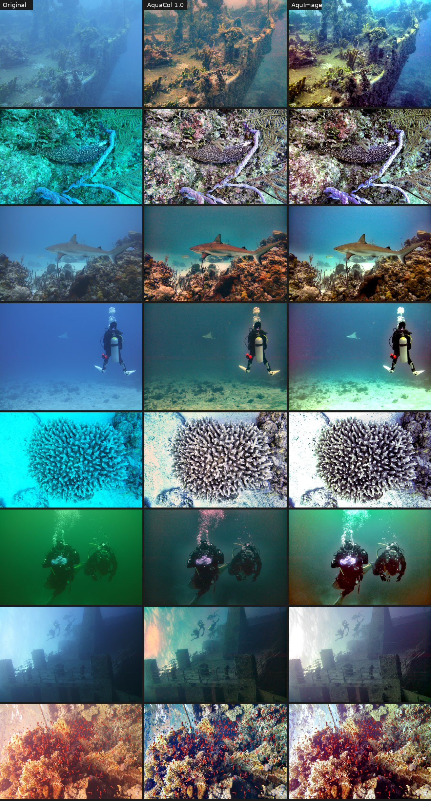

# AquImage

Correction automatique des photos et vidéos de plongée, pour usage personnel. Sans licence et sans connexion : tout tourne sur votre ordinateur.



## Démarrer

Double-cliquez sur **`AquImage.bat`**.

- Au premier lancement, le fichier crée un environnement Python dans `%LOCALAPPDATA%\AquImage\venv`, hors de OneDrive pour ne pas synchroniser des milliers de fichiers, puis installe les dépendances. Comptez quelques minutes.
- L'interface s'ouvre ensuite dans votre navigateur, à l'adresse `http://127.0.0.1:8765`. Elle ne fonctionne que sur cet ordinateur.
- Fermez la fenêtre noire pour quitter.

Python 3.9 ou plus récent est nécessaire. Le lanceur trouve `C:\Python\Python39`, sinon `py` ou `python`.

Pour corriger un dossier sans ouvrir l'interface, glissez-le sur **`Corriger un dossier.bat`**. Les fichiers corrigés vont dans un sous-dossier `AquImage` de ce dossier.

## Lot : toute une plongée d'un coup

1. Choisissez le dossier des originaux et celui des fichiers corrigés.
2. Cliquez sur **Corriger le dossier**.

Chaque photo et chaque vidéo reçoit **ses propres réglages**, estimés d'après sa dominante de couleur, son voile, son bruit et la couleur de l'eau. Les originaux ne sont jamais modifiés.

- **Sous-dossiers :** ils sont recréés à l'identique dans la destination.
- **Fichiers déjà corrigés :** ils sont ignorés, ce qui permet de relancer un lot interrompu. Cochez « Refaire » pour les recalculer.
- **Ajustements communs :** ils s'ajoutent aux réglages automatiques de chaque fichier, par exemple un peu plus chaud pour toute une plongée.
- **Réglages identiques pour tous :** cette option reprend les réglages faits dans l'atelier sur une photo.
- **Rapport :** `aquimage_rapport.csv` est écrit dans la destination. Il contient, pour chaque fichier, le type d'image détecté, les réglages retenus, la durée et les erreurs éventuelles. Il s'ouvre dans Excel.
- **Dossiers de sortie :** un dossier nommé `AquImage`, ou contenant un rapport, n'est jamais retraité.

## Atelier : une photo à la fois

- La colonne de gauche montre les photos et vidéos du dossier. Les flèches du clavier passent à la suivante.
- Faites glisser le séparateur orange pour comparer l'original et la photo corrigée. Maintenez **Espace** pour voir l'original en entier.
- La molette zoome et le glisser déplace l'image. Un double-clic ajuste l'image à la fenêtre.
- Les curseurs partent des valeurs automatiques. Un double-clic sur un nom de curseur le ramène à sa valeur automatique.
- **L'aperçu est fidèle à l'export :** les réglages ne dépendent pas de la résolution. L'écart mesuré entre l'aperçu et l'export pleine résolution est de 0,85 niveau sur 255.
- **Enregistrer** produit le fichier en pleine résolution. Pour une vidéo, **Exporter la vidéo** traite le clip entier.

| Curseur | Effet |
| --- | --- |
| Compensation du rouge | Reconstruit le rouge absorbé par l'eau, là où le vert porte du signal |
| Correction de la dominante | Neutralise la teinte bleue ou verte globale |
| Bleu gardé dans l'eau lointaine | 0 rend l'eau du fond grise ; plus haut, elle reste bleue tandis que les sujets proches sont corrigés |
| Température, Teinte | Réglages créatifs, du froid au chaud et du vert au magenta |
| Retrait du voile | Enlève la brume de l'eau et rend du contraste aux sujets lointains |
| Protection contre le bruit au loin | Limite l'amplification du bruit dans les zones très voilées |
| Luminosité, Contraste local, Saturation | Réglages de tonalité |

## Vidéos

- **Réglages stables :** ils sont estimés une fois par vidéo, sur 8 images clés, pour que la couleur ne scintille pas. Seul le voile est suivi image par image, avec un lissage dans le temps.
- **Encodage :** H.264 avec le son d'origine (converti en AAC) et la date de prise de vue. La sortie est toujours en `.mp4`.
- **Vitesse :** sur la machine de test (2 cœurs), un clip 1080p à 30 i/s se traite à environ 4 images par seconde. Un ordinateur à 8 cœurs ira nettement plus vite.

## Formats

| Entrée | Sortie |
| --- | --- |
| JPEG, PNG, TIFF, WebP, BMP | Même format, ou JPEG / TIFF / PNG au choix |
| PNG et TIFF 16 bits | 16 bits conservé |
| MP4, MOV, AVI, MKV, M4V, MTS | MP4 H.264 + AAC |

L'EXIF est conservé (appareil, date, réglages de prise de vue), tout comme le profil de couleur ICC. Une photo prise en portrait est redressée. Les chemins avec accents, comme « Plongée été », sont gérés.

Le RAW et le HEIC ne sont pas encore lus : convertissez-les d'abord en TIFF 16 bits ou en JPEG.

## Ligne de commande

```bat
AquImage.bat lot "D:\Plongées\Brut" "D:\Plongées\Corrigées"
AquImage.bat lot SOURCE DEST --format jpg --qualite 92 --ajuste temperature=0.2
AquImage.bat image entree.jpg sortie.jpg
AquImage.bat ui --port 8800
```

`AquImage.bat lot --help` liste toutes les options.

## Comment ça marche

AquImage estime tout sur une copie réduite d'environ 0,3 Mpx. Il applique ensuite le résultat à la pleine résolution, par bandes de lignes, ce qui borne la mémoire utilisée.

1. **Compensation des canaux affaiblis.** Méthode d'Ancuti et al. (2018) : R' = R + (Ḡ − R̄)(1 − R)·G. Le bleu est compensé de la même façon en eau verte.
2. **Balance des blancs.** Méthode « gray-world » en lumière linéaire, calculée surtout sur les sujets proches pour que l'eau, souvent majoritaire, n'impose pas sa couleur.
3. **Retrait du voile.** Prior du canal sombre (He et al. 2011). La lumière de l'eau est cherchée par quadtree, dans une zone voilée et uniforme, pour ne pas confondre un objet clair avec l'eau. La transmission est affinée par filtre guidé. La soustraction est bornée pixel par pixel, ce qui évite les ombres violettes.
4. **Correction graduée.** Elle est pleine sur les sujets proches et partielle sur l'eau très lointaine, qui reste bleue au lieu de virer au gris ou au magenta. La part gardée est choisie automatiquement en testant les pixels lointains.
5. **Tonalité.** Niveaux, gamma automatique des tons moyens, hautes lumières écrêtées ramenées vers le blanc, saturation et clarté (contraste local guidé, sans halo).

Ce que l'auto-réglage détecte, image par image :

| Cas détecté | Réglages appliqués |
| --- | --- |
| Vraie dominante sous-marine | Correction complète |
| Dominante légère | Correction modérée |
| Photo déjà équilibrée (flash, mode plongée de l'appareil) | Correction douce |
| Filtre rouge | Correction sans compensation du rouge |

Le niveau de bruit règle aussi le retrait du voile, et le contraste obtenu règle la clarté. Ces règles ont été calibrées sur 35 photos réelles (SeaLife DC2000) et sur 24 scènes simulées dont on connaît la vraie couleur.

**Limite connue :** en eau bleue profonde, sans sujet proche, l'eau peut garder une légère teinte lavande. Le curseur Teinte vers le vert, ou « Bleu gardé » plus haut, la corrige.

## Développement

```bat
%LOCALAPPDATA%\AquImage\venv\Scripts\python -m pip install -r requirements-dev.txt
%LOCALAPPDATA%\AquImage\venv\Scripts\python -m pytest tests
%LOCALAPPDATA%\AquImage\venv\Scripts\python -m bench.evaluate
```

```
aquimage/
  core.py       moteur de correction (estimer petit, appliquer en grand)
  autotune.py   réglages automatiques par image et par vidéo
  fileio.py     lecture et écriture (EXIF, ICC, 16 bits, chemins Unicode)
  video.py      vidéos (réglages par clip, lissage, ffmpeg + son)
  batch.py      traitement par lot et rapport CSV
  server.py     serveur local et API (bibliothèque standard seulement)
  web/          interface (HTML, CSS, JavaScript sans dépendance)
bench/          banc d'essai à vérité terrain
tests/          tests automatiques (pytest)
```

Références : Ancuti et al., *Color Balance and Fusion for Underwater Image Enhancement*, IEEE TIP 2018. He, Sun et Tang, *Single Image Haze Removal Using Dark Channel Prior*, TPAMI 2011. He et Sun, *Fast Guided Filter*, 2015. Kim et al., *Optimized contrast enhancement for real-time image and video dehazing*, JVCIR 2013.
