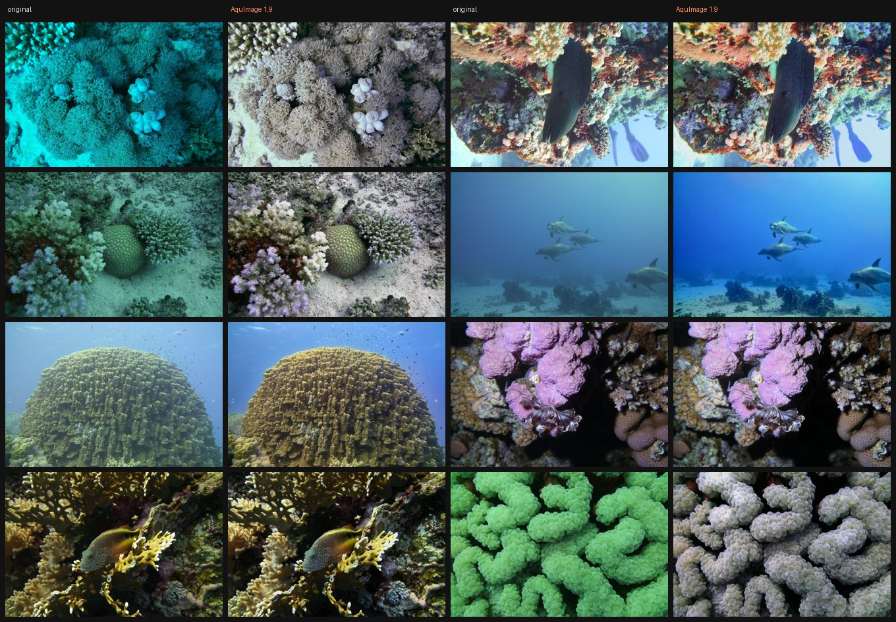
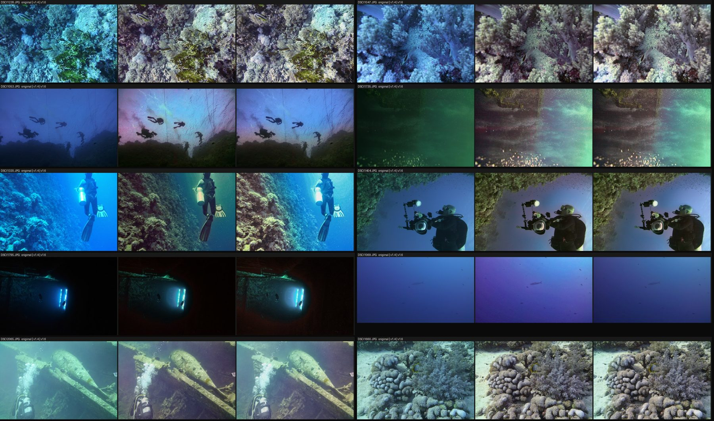
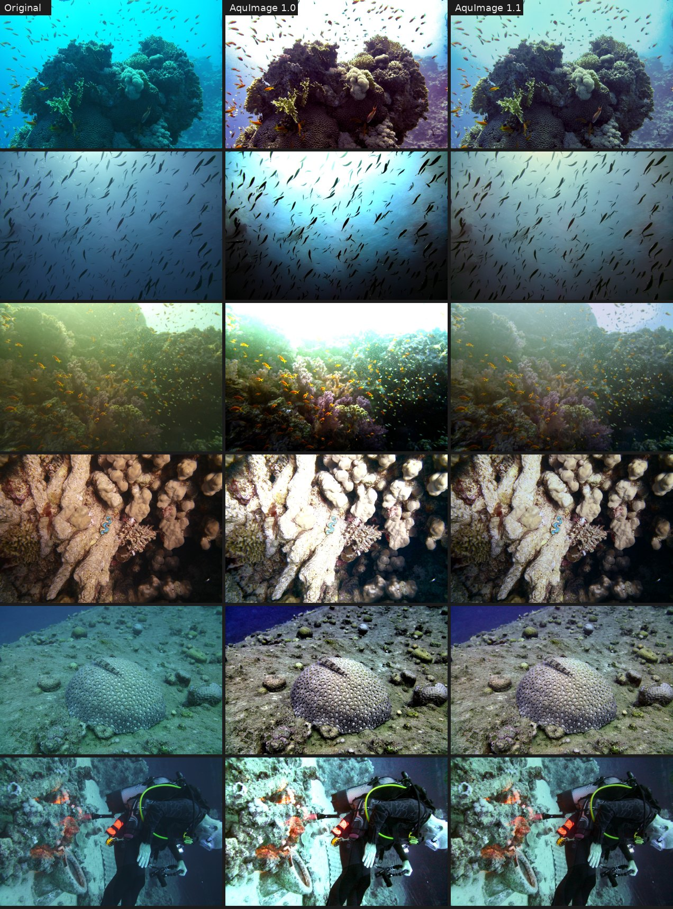

# AquImage

Correction automatique des photos et vidéos de plongée, pour usage personnel. Sans licence et sans connexion : tout tourne sur votre ordinateur.



**Ce que fait AquImage**
- **Correction automatique :** il rend le rouge absorbé par l'eau, retire le voile, garde l'eau lointaine bleue, et préserve les hautes lumières et les fonds noirs.
- **Lot :** toute une plongée est corrigée d'un coup, avec des réglages estimés pour chaque photo et chaque vidéo.
- **Atelier :** comparaison avant / après et réglages fins sur une photo ou une vidéo.
- **Édition :** rotation, recadrage, découpe et stabilisation des vidéos.
- **Interface :** en français, anglais, espagnol et allemand.

**Sommaire :**
[Installer et mettre à jour](#installer-et-mettre-à-jour) ·
[Lot](#lot--toute-une-plongée-dun-coup) ·
[Atelier](#atelier--une-photo-à-la-fois) ·
[Édition](#édition) ·
[Vidéos](#vidéos) ·
[Raccourcis](#raccourcis-clavier) ·
[Formats](#formats) ·
[Ligne de commande](#ligne-de-commande) ·
[Comment ça marche](#comment-ça-marche) ·
[Historique](#historique)

## Installer et mettre à jour

Double-cliquez sur **`AquImage.bat`**.

- Au premier lancement, le fichier crée un environnement Python dans `%LOCALAPPDATA%\AquImage\venv` et installe les dépendances. Ce dossier est volontairement hors de OneDrive, pour ne pas synchroniser des milliers de fichiers. Comptez quelques minutes.
- L'interface s'ouvre ensuite dans votre navigateur, à l'adresse `http://127.0.0.1:8765`. Elle ne fonctionne que sur cet ordinateur.
- La version s'affiche à côté du nom, en haut à gauche.
- Fermez la fenêtre noire pour quitter.

Python 3.9 ou plus récent est nécessaire. Le lanceur trouve `C:\Python\Python39`, sinon `py` ou `python`.

**Mettre à jour :** fermez AquImage, puis, dans le dossier du programme :

```bat
git pull
AquImage.bat
```

Rechargez ensuite la page du navigateur avec Ctrl+F5.

Si `git pull` signale des modifications locales, en général de simples fins de ligne, écrasez-les avec `git reset --hard origin/main`. Vos photos ne sont pas concernées.

Si `git pull` dit que la branche n'est reliée à rien, reliez-la une fois pour toutes avec `git branch --set-upstream-to=origin/main main`.

**Langue :** choisissez-la en haut à droite ; le choix est mémorisé. Le rapport CSV et la ligne de commande restent en français.

**Sans interface :** glissez un dossier sur **`Corriger un dossier.bat`**. Les fichiers corrigés vont dans un sous-dossier `AquImage` de ce dossier.

## Lot : toute une plongée d'un coup

1. Choisissez le dossier des originaux et celui des fichiers corrigés.
2. Cliquez sur **Corriger le dossier**.

Chaque photo et chaque vidéo reçoit **ses propres réglages**, estimés d'après sa dominante de couleur, son voile, son bruit et la couleur de l'eau. Les originaux ne sont jamais modifiés.

- **Sous-dossiers :** ils sont recréés à l'identique dans la destination.
- **Reprise :** les fichiers déjà corrigés sont ignorés, ce qui permet de relancer un lot interrompu. Cochez « Refaire » pour les recalculer.
- **Doublons :** les copies identiques (« X 2.JPG », « X 2.MOV ») sont ignorées et notées dans le rapport.
- **Ajustements communs :** ils s'ajoutent aux réglages automatiques de chaque fichier, par exemple un peu plus chaud pour toute une plongée.
- **Réglages de l'atelier respectés :** une photo ou une vidéo réglée à la main dans l'atelier (curseurs, rotation, recadrage, découpe, stabilisation) est traitée avec ces réglages-là. Décochez l'option pour tout refaire en automatique.
- **Séries harmonisées :** des photos de la même scène prises à quelques secondes d'intervalle reçoivent des réglages voisins, pour qu'une rafale ne change pas de rendu d'une image à l'autre.
- **Réglages identiques pour tous :** cette option reprend les réglages faits dans l'atelier sur une photo. Le recadrage et la rotation, eux, restent propres à chaque photo.
- **Rapport :** `aquimage_rapport.csv`, écrit au fil du traitement, contient pour chaque fichier le type d'image détecté, les réglages, la durée et les erreurs. Il s'ouvre dans Excel.
- **Filtres :** la liste se filtre par état (à traiter, corrigés, ignorés, erreurs) et par type (photos ou vidéos).
- **Ouvrir le dossier de sortie :** ce bouton ouvre la destination dans l'Explorateur Windows.
- **Dossiers de sortie :** un dossier nommé `AquImage`, ou contenant un rapport, n'est jamais retraité.

## Atelier : une photo à la fois

- **Colonne de gauche :** les photos et vidéos du dossier. Le menu filtre par type. « Masquer les déjà enregistrées » cache celles qui ont déjà une version dans le dossier « Enregistrer dans » ; ces dernières portent une coche ✓.
- **Comparaison :** faites glisser le séparateur orange entre l'original et la photo corrigée. Maintenez **Espace** pour voir l'original en entier.
- **Navigation :** la molette zoome, le glisser déplace l'image, le double-clic l'ajuste à la fenêtre.
- **Curseurs :** ils partent des valeurs automatiques. Un double-clic sur un nom de curseur le ramène à sa valeur automatique.
- **Réglages conservés :** ce que vous modifiez est enregistré aussitôt pour ce fichier, dans `aquimage_reglages.json`, à côté des originaux (qui ne sont pas touchés). Vous le retrouvez en rouvrant la photo, et le lot en tient compte. Les fichiers concernés portent un crayon ✎. « Revenir aux réglages auto » efface ces réglages.
- **Annuler, rétablir :** boutons ↶ ↷ ou **Ctrl+Z** et **Ctrl+Y**, pour les curseurs comme pour la rotation, le recadrage et la découpe.
- **Copier, coller les réglages :** boutons ou **Ctrl+C** et **Ctrl+V**, pour reporter les réglages de couleur d'une photo sur une autre.
- **Aperçu fidèle :** les réglages ne dépendent pas de la résolution ; l'aperçu et l'export pleine résolution diffèrent d'environ 1 niveau sur 255.
- **Enregistrer** produit le fichier en pleine résolution ; **Exporter la vidéo** traite le clip entier. **Ouvrir le dossier** affiche ensuite le fichier dans l'Explorateur.

| Curseur | Effet |
| --- | --- |
| Compensation du rouge | Reconstruit le rouge absorbé par l'eau, là où le vert porte du signal |
| Correction de la dominante | Neutralise la teinte bleue ou verte globale |
| Bleu gardé dans l'eau lointaine | 0 rend l'eau du fond grise ; plus haut, elle reste bleue tandis que les sujets proches sont corrigés |
| Température, Teinte | Réglages créatifs, du froid au chaud et du vert au magenta |
| Retrait du voile | Enlève la brume de l'eau et rend du contraste aux sujets lointains |
| Protection contre le bruit au loin | Limite l'amplification du bruit dans les zones très voilées |
| Réduction du bruit | Lisse le grain et le bruit de couleur dans l'eau, les zones lisses et les ombres, sans toucher aux contours |
| Luminosité | Plus clair ou plus sombre (tons moyens) |
| Éclaircir les ombres | Débouche les sujets sombres, utile en contre-jour |
| Contraste local | Clarté des détails, appliquée aux tons moyens seulement |
| Vibrance | Ravive les couleurs ternes sans pousser celles déjà vives |
| Saturation | Intensité de toutes les couleurs |

## Édition

Les outils de la section **Édition**, en haut du panneau de droite :

- **Rotation par quarts de tour :** boutons ↺ ↻ sous l'image, ou touches **R** et **Maj+R**. Le fichier enregistré est réellement tourné, avec une orientation EXIF neutre.
- **Recadrage :** bouton **Recadrer** ou touche **C**.
  - Tracez un cadre sur l'image, déplacez-le, ou ajustez-le par ses poignées. Une grille des tiers aide à composer.
  - Formats : libre, celui de l'original, 3:2, 4:3, 16:9, 1:1 ou 4:5.
  - **Entrée** termine, et le panneau indique la taille finale en pixels.
  - « Sans recadrage » annule le cadre. Une rotation l'annule aussi.
- **Vidéo, découpe :** les curseurs **Début** et **Fin** choisissent l'extrait exporté, son compris. En les déplaçant, on affiche l'image correspondante.
- **Vidéo, stabilisation :** cochez **Stabiliser la vidéo** et réglez la force.
  - Le tremblé est analysé à l'export, puis compensé.
  - L'image est légèrement agrandie pour masquer les bords (15 % au maximum).
  - L'aperçu ne montre pas la stabilisation.

Rotation, recadrage, découpe et stabilisation sont mémorisés pour la photo ou la vidéo ouverte. Ils sont appliqués à l'enregistrement ; les originaux ne sont jamais modifiés.

## Vidéos

- **Réglages stables :** ils sont estimés une fois par vidéo, sur 8 images clés prises dans la partie gardée, pour que la couleur ne scintille pas. Seul le voile est suivi image par image, avec un lissage dans le temps.
- **Ordre des opérations à l'export :** découpe, rotation, stabilisation, recadrage, puis correction des couleurs.
- **Stabilisation :**
  - des points sont suivis d'une image à l'autre (Lucas-Kanade), puis le mouvement est estimé (translation et rotation) ;
  - la trajectoire est lissée sur 0,5 à 2 secondes, selon la force choisie ;
  - sur une vidéo test secouée, le tremblé passe de 10,5 pixels à 0,06 pixel par image.
- **Encodage :** H.264 (CRF 21, débit plafonné à celui de la source), avec le son d'origine converti en AAC et la date de prise de vue. La sortie est toujours en `.mp4`.
- **Vitesse :** sur la machine de test (2 cœurs), un clip 1080p à 30 i/s se traite à environ 4 images par seconde (2 avant la 1.10). La stabilisation ajoute environ un quart de temps. Un ordinateur à 8 cœurs ira nettement plus vite.

## Raccourcis clavier

Dans l'atelier :

| Touche | Action |
| --- | --- |
| ← → | Photo précédente ou suivante (parmi les fichiers affichés) |
| Espace (maintenue) | Voir l'original |
| R / Maj+R | Pivoter à droite / à gauche |
| C | Recadrer (afficher ou masquer le cadre) |
| Entrée, Échap | Terminer le recadrage |
| Molette, double-clic | Zoom, ajuster à la fenêtre |
| Ctrl+Z / Ctrl+Y | Annuler / rétablir la dernière modification |
| Ctrl+C / Ctrl+V | Copier / coller les réglages de couleur |

## Formats

| Entrée | Sortie |
| --- | --- |
| JPEG, PNG, TIFF, WebP, BMP | Même format, ou JPEG / TIFF / PNG au choix |
| PNG et TIFF 16 bits | 16 bits conservé |
| MP4, MOV, AVI, MKV, M4V, MTS | MP4 H.264 + AAC |

- **Métadonnées :** l'EXIF est conservé (appareil, date, réglages de prise de vue), tout comme le profil de couleur ICC.
- **Orientation :** une photo prise en portrait est redressée.
- **Chemins :** les noms avec accents, comme « Plongée été », sont gérés.
- **JPEG :** qualité 92 en 4:2:0 par défaut. Une sortie fait à peu près la taille de l'original.

Le RAW et le HEIC ne sont pas encore lus : convertissez-les d'abord en TIFF 16 bits ou en JPEG.

## Ligne de commande

```bat
AquImage.bat lot "D:\Plongées\Brut" "D:\Plongées\Corrigées"
AquImage.bat lot SOURCE DEST --format jpg --qualite 92 --ajuste temperature=0.2
AquImage.bat image entree.jpg sortie.jpg
AquImage.bat ui --port 8800
```

`AquImage.bat lot --help` liste toutes les options. Rotation, recadrage et stabilisation ne sont disponibles que dans l'atelier.

## Comment ça marche

AquImage estime tout sur une copie réduite d'environ 0,3 Mpx. Il applique ensuite le résultat à la pleine résolution, par bandes de lignes, ce qui borne la mémoire utilisée.

1. **Compensation des canaux affaiblis.** Méthode d'Ancuti et al. (2018) : R' = R + (Ḡ − R̄)(1 − R)·G. Le bleu est compensé de la même façon en eau verte.
2. **Balance des blancs.** Méthode « gray-world » en lumière linéaire, calculée surtout sur les sujets proches pour que l'eau, souvent majoritaire, n'impose pas sa couleur.
3. **Retrait du voile.** Prior du canal sombre (He et al. 2011). La lumière de l'eau est cherchée par quadtree, dans une zone voilée et uniforme. La transmission est affinée par filtre guidé, et la soustraction est bornée pixel par pixel.
4. **Eau et sujets traités différemment.**
   - **Une carte « eau ou sujet » est dressée.** L'eau, ce sont les grandes zones lisses de sa couleur. Les sujets, ce sont les zones texturées : récif, épave, sable, reconnu à son grain. Poissons et bulles isolés sont ignorés.
   - **Les sujets sont corrigés en entier, même au loin.**
   - **L'eau garde sa teinte**, orientée vers un bleu azur quand l'appareil l'a enregistrée trop cyan. On n'y restaure que la luminance, pour ne pas amplifier plancton et bruit.
5. **Garde-fous de couleur.**
   - **Rouge reconstruit plafonné.** Là où l'original n'en a plus, il ne dépasse pas celui d'un sable beige : pas de taches orange.
   - **Pas de rouge amplifié sans lumière.** Les noirs restent noirs, sans teinte bordeaux.
   - **Pas de pourpre.** Le magenta et la lavande sont retirés des ombres, des tons neutres et des zones lisses. Les vrais sujets violets, texturés, sont préservés.
6. **Tonalité, sans rien couper.**
   - **Niveaux :** étirement limité (×2,5 au plus), point noir adouci, plus bas en eau laiteuse.
   - **Exposition :** elle se règle sur les hautes lumières non écrêtées.
   - **Tons moyens :** éclaircissement modéré, surtout sur la luminance, pour garder les couleurs. Une photo qui a déjà de vrais noirs et de vraies lumières (flash, fond noir) n'est presque pas éclaircie.
   - **Finitions :** vibrance, puis clarté sur les tons moyens. Enfin, une épaule douce compresse les hautes lumières vers le blanc sans les écrêter.

Ce que l'auto-réglage détecte, image par image :

| Cas détecté | Réglages appliqués |
| --- | --- |
| Vraie dominante sous-marine | Correction complète |
| Dominante légère | Correction modérée |
| Photo déjà équilibrée (flash, mode plongée de l'appareil) | Correction douce |
| Filtre rouge | Correction sans compensation du rouge |
| Contre-jour vers la surface | Voile moins retiré, ombres débouchées, ciel préservé |
| Pleine eau sans sujet, même en dégradé de lumière | Pas d'étirement ni de vibrance, l'eau reste azur |
| Ombres virant au violet | Balance des blancs réduite automatiquement |
| Photo déjà bien exposée | Ni éclaircissement marqué, ni ombres débouchées |
| Ciel, ou rouge bien présent malgré une moyenne bleue | Traitée comme déjà équilibrée : correction douce |
| Photo chaude aux blancs neutres (intérieur, bateau le soir) | Laissée presque intacte (« hors de l'eau ») |
| Sable ou roche rosis ou jaunis par le mode plongée de l'appareil | Dominante retirée, zone par zone |

Le niveau de bruit règle aussi le retrait du voile, et le contraste obtenu règle la clarté. Depuis la 1.10, ces décisions sont progressives : deux photos presque identiques ne basculent plus d'un rendu à l'autre.

**Validation :** ces règles ont été calibrées sur 35 photos réelles et sur 24 scènes simulées dont on connaît la vraie couleur. Elles ont ensuite été vérifiées sur 1 045 photos d'un voyage en mer Rouge (SeaLife DC2000) et sur une sélection de 131 favoris. Les chiffres de chaque version sont dans l'historique.

**Limites connues :**
- **Dominantes déjà poussées :** le rose et le jaune sont retirés du sable et de la roche, mais un récif entièrement rosi par le mode plongée de l'appareil garde une partie de sa dominante. Les curseurs Teinte et Température la corrigent.
- **Épaves en eau verte très voilée :** elles peuvent garder une tache verte ou violette (DSCI1731, 1803).
- **Photos hors de l'eau :** un paysage avec du ciel reçoit une correction douce, pas toujours nulle. Un coucher de soleil ressemble à une photo prise avec un filtre rouge et est corrigé comme elle : mieux vaut ne pas passer ces photos dans le lot.
- **Bruit :** la réduction du bruit reste modeste, elle n'efface pas le grain d'une photo très voilée.

## Historique

### 1.10.0

**Atelier**
- **Réglages conservés par photo :** curseurs, rotation, recadrage, découpe et stabilisation sont enregistrés pour chaque fichier (`aquimage_reglages.json`, à côté des originaux) et retrouvés à la réouverture. Le lot les respecte.
- **Annuler et rétablir** (Ctrl+Z, Ctrl+Y), **copier et coller les réglages** (Ctrl+C, Ctrl+V).
- **Nouveau curseur :** Réduction du bruit.

**Vitesse**
- **Photos :** une photo de 20 Mpx se corrige en 1,8 s au lieu de 9,1 s sur la machine de test (2 cœurs) : bandes traitées en parallèle, calculs par plan de couleur, plus rien de calculé deux fois. Le résultat est le même, à 1 niveau sur 255 près sur moins de 0,01 % des pixels.
- **Vidéos :** environ 4 images par seconde au lieu de 2 en 1080p.

**Correction**
- **Décisions progressives :** les seuils nets (pleine eau, contre-jour, type de dominante, eau libre) sont devenus des transitions.
- **Séries harmonisées :** les photos d'une même scène prises à moins de 8 secondes reçoivent des réglages voisins. Sur le voyage test, 402 photos sur 1 045 sont dans une série.
- **Sable et roche rosis ou jaunis :** la dominante laissée par le mode plongée de l'appareil est retirée zone par zone.
- **Photos hors de l'eau :** un ciel, ou du rouge bien présent, font traiter la photo comme déjà équilibrée ; une photo chaude aux blancs neutres est laissée presque intacte.
- **Réduction du bruit :** grain et bruit de couleur lissés dans l'eau, les zones lisses et les ombres, selon ce que la correction a amplifié. L'effet reste modeste.

Mesure sur les 1 045 photos du voyage test, copies réduites :

| Nombre de photos | 1.9.1 | 1.10 | Original |
| --- | --- | --- | --- |
| Tons clairs roses sur plus de 10 % de l'image | 7 | 2 | 18 |
| Pourpre sur plus de 2 % de l'image | 31 | 26 | 78 |
| Éclaircies de plus de 10 points | 82 | 67 | — |
| Assombries de plus de 10 points | 7 | 8 | — |
| Paires d'une même série au rendu de couleur différent | 36 | 25 | — |
| Tons clairs jaunes sur plus de 10 % de l'image | 47 | 53 | 28 |
| Bruit doublé ou plus (à cette échelle, la réduction du bruit ne se voit pas) | 100 | 109 | — |
| Blancs écrêtés (plus de 1 %) | 0 | 0 | 208 |

Pas d'amélioration sur les tons jaunes ni sur les épaves en eau verte (DSCI1731, 1803), qui restent dans les limites connues.

**Développement**
- **Banc sur vraies photos :** 32 photos réduites dans `tests/photos`, avec leurs mesures de référence. `pytest` signale toute dérive ; `python tests/photo_bench.py` montre les écarts et `--update` enregistre la nouvelle référence.

### 1.9.1

- **Correctif vidéo :** l'export échouait avec « OSError: [Errno 22] Invalid argument » quand la piste son était plus courte que l'image, ce qui est fréquent. Depuis la 1.8, l'option `-shortest` faisait arrêter ffmpeg à la fin du son, alors qu'AquImage envoyait encore des images. L'option est retirée, et si ffmpeg s'arrête malgré tout, son propre message d'erreur est affiché.

### 1.9.0

Retour sur DSCI2004 et d'autres photos jugées trop claires et fades.

- **Photos déjà bien exposées :** une photo qui a déjà de vrais noirs et de vraies hautes lumières (flash, fond noir volontaire) n'est presque plus éclaircie, et ses ombres ne sont plus débouchées. DSCI2004 garde son fond noir.
- **Couleurs plus riches :** l'éclaircissement des tons moyens s'applique en grande partie à la luminance seule, au lieu de chaque canal séparément ; ce dernier pâlissait les couleurs. Cela ne s'applique pas là où le rouge est entièrement reconstruit, pour ne pas faire apparaître de fausses couleurs.
- **Sur les 131 photos de la sélection :** 18 photos sont éclaircies de plus de 8 points au lieu de 29. Les couleurs vives gagnent en saturation (chroma au 90e centile : 25,5 → 26,7), sans plus de pourpre.

### 1.8.0

- **Édition dans l'atelier :** recadrage par cadre, pour les photos et les vidéos, avec choix du format.
- **Découpe vidéo :** début et fin de l'extrait exporté.
- **Stabilisation vidéo :** sur une vidéo test secouée, le mouvement parasite passe de 10,5 pixels à 0,06 pixel par image, avec 6 % de recadrage.
- **Ordre des opérations à l'export vidéo :** découpe, rotation, stabilisation, recadrage, puis correction des couleurs. Les réglages automatiques sont estimés sur la partie gardée.

### 1.7.1

- Le numéro de version est affiché dans l'en-tête de l'application et dans l'onglet du navigateur.

### 1.7.0

Améliorations tirées de la sélection de 131 photos favorites (`PHOTOS\MER ROUGE OCT 2026\RAW`).

- **Taches orange et rouge-violet :** là où l'original n'a quasiment plus de rouge (sable très bleu, eau), tout le rouge est reconstruit. Il est désormais plafonné à celui d'un sable beige. Les halos orange autour des raies (DSCI0909, 0915) et les nuages rouge-violet dans l'eau (DSCI2026, 1390) disparaissent.
- **Eau voilée :** l'eau est reconnue comme les grandes zones lisses ayant sa couleur, même quand l'estimation de distance la croit proche. L'eau de DSCI2026 et DSCI1403 est enfin bleue et homogène.
- **Poissons et bulles :** ils ne comptent plus comme des sujets, et ne font plus corriger l'eau autour d'eux.
- **Pas de lavande ni de magenta dans les zones lisses** (eau, voile, sable) : DSCI1807, 1589. Les vrais sujets violets (coraux mous, éponges), texturés, sont préservés.

### 1.6.3

Retour sur DSCI0898, 0900, 0940 et 0943 : l'eau tirait sur le cyan, et le sable clair restait cyan ou devenait mauve.

- **Eau bleue :** l'eau libre lointaine est orientée vers un bleu azur profond (moins de vert, plus de bleu) quand l'appareil l'a enregistrée trop cyan. Une eau déjà bleue n'est pas touchée.
- **Bord de l'eau :** l'eau qui longe un récif ou un plongeur, lisse et sans rouge dans l'original, garde aussi sa teinte. Le mauve qui y apparaissait (DSCI0943) disparaît.
- **Sable :** il est reconnu par son grain, et non plus confondu avec de l'eau. Sur DSCI0900, il redevient beige au lieu de rester cyan.
- **Tons neutres :** la légère teinte lavande ou rose du sable et de la roche est retirée.

Sur les 1 045 photos, par rapport à la 1.6.2 :
- eau restée cyan : 52 photos au lieu de 61 (103 dans les originaux) ;
- ombres pourpres : 6 au lieu de 11 ;
- bruit doublé : 117 au lieu de 153.

L'eau est plus colorée, avec une saturation médiane de 123 au lieu de 109 (140 dans les originaux). C'est pourquoi l'indicateur de sursaturation monte, de 31 à 51 photos.

### 1.6.2

- **Atelier :** le filtre de la colonne est simplifié : un menu pour le type, et une case « Masquer les déjà enregistrées ». Il n'y a plus deux boutons « Tous » et « Tout », et les nombres ne changent plus selon l'autre filtre.
- **Lot :** les nombres des filtres sont fixes. Le bouton de type s'appelle « Photos et vidéos ».

### 1.6.1

Corrections après examen de DSCI1795 (intérieur d'épave) et DSCI2065 (épave en eau verte), mal rendus par la 1.6.0.

- **Noirs bordeaux :** la 1.6.0 les aggravait. Le garde-fou ne visait que le magenta des quasi-noirs, alors que le rouge venait du bruit amplifié. Désormais, les gains qui amplifient un canal (rouge surtout) et la compensation s'éteignent là où l'original n'a presque pas de lumière ; les réductions de canal restent appliquées.
- **Épaves et récifs lointains :** ils sont de nouveau corrigés en entier. Seule l'eau lisse garde sa teinte. Un contour isolé (silhouette sur l'eau) ne compte pas comme une texture, ce qui évite un halo.
- **Eau laiteuse :** le point noir est plus bas, et les tons moyens peuvent remonter davantage, pour éviter le rendu délavé.

Sur les 1 045 photos du voyage :

| Défaut (nombre de photos) | 1.4 | 1.6.0 | 1.6.1 | Original |
| --- | --- | --- | --- | --- |
| Ombres pourpres ou magenta | 73 | 12 | 11 | 9 |
| Ombres rouges ou brique | 45 | 51 | 43 | 45 |
| Noirs laiteux | 42 | 69 | 34 | 226 |
| Assombries de plus de 10 points | 43 | 3 | 8 | — |
| Assombries de plus de 5 points | 150 | 48 | 92 | — |
| Bruit doublé ou plus | 151 | 120 | 153 | — |



### 1.6.0

Suite de l'analyse des 1 045 photos du voyage Mer Rouge 2026 corrigées en 1.4. Mêmes photos, mêmes mesures, avant et après :

| Défaut (nombre de photos sur 1 045) | 1.4 | 1.6 | Original |
| --- | --- | --- | --- |
| Ombres pourpres ou magenta | 73 | 12 | 9 |
| Assombries de plus de 10 points | 43 | 3 | — |
| Assombries de plus de 5 points | 150 | 48 | — |
| Bruit doublé ou plus | 151 | 120 | — |
| Blancs écrêtés (plus de 1 %) | 0 | 0 | — |

Sur un échantillon de 40 photos, la part de pixels pourpres passe de 1,9 % à 0,2 % (0,06 % dans les originaux), et les taches de couleur dans l'eau lisse reculent d'environ 20 %.

- **Ombres pourpres :** le magenta est retiré des tons sombres, et les quasi-noirs perdent leur teinte bordeaux.
- **Eau bleue :** l'eau lointaine garde sa couleur. Les gains et la compensation suivent une carte de distance lissée, au lieu des marbrures de la carte fine.
- **Taches dans l'eau :** au loin, seule la luminance est restaurée, pour ne pas amplifier le plancton, les bulles et le bruit.
- **Assombrissement :**
  - l'exposition se règle sur les hautes lumières non écrêtées ;
  - l'auto-gamma n'assombrit plus nettement une photo claire.
- **Pleine eau :** elle est aussi détectée quand l'eau est en dégradé. Elle ne vire plus à l'indigo.


### 1.5.0

- **Ouvrir le dossier :** un bouton ouvre la destination du lot dans l'Explorateur Windows. Dans l'atelier, il sélectionne directement le fichier que vous venez d'enregistrer ou d'exporter.

### 1.4.0

- **Filtres dans le lot :** par état (tous, à traiter, corrigés, ignorés, erreurs) et par type (photos, vidéos), avec le nombre de fichiers sur chaque bouton.
- **Filtres dans la colonne de l'atelier :** « À corriger » (pas encore enregistrés dans le dossier de destination, les autres portent une coche ✓), photos ou vidéos. Les flèches ne parcourent que les fichiers affichés.

### 1.3.0

- **Atelier :** rotation par pas de 90°, avec les boutons ↺ ↻ ou les touches R et Maj+R. Elle est appliquée à l'enregistrement en pleine résolution comme à l'export vidéo, avec une orientation EXIF neutre pour éviter une double rotation dans les visionneuses.
- **Langues :** l'interface est disponible en français, anglais, espagnol et allemand.
  - Le choix se fait en haut à droite. Il est mémorisé dans `~/.aquimage.json` ; par défaut, l'interface suit la langue du navigateur.
  - Les diagnostics d'analyse (« sous-marine », « contre-jour »…) et les messages du lot sont traduits.
  - Le rapport CSV et la ligne de commande restent en français.

### 1.2.0

Suite de l'analyse complète du voyage Mer Rouge 2026 (1 061 photos uniques et vidéos).

- **Doublons ignorés :** les copies identiques (« X 2.JPG », « X 2.MOV ») sont détectées par taille et empreinte, puis ignorées et notées dans le rapport (« doublon de … »). Sur ce voyage, cela représente 595 fichiers, 6,3 Go et un tiers du temps de calcul. Option « Ignorer les doublons » dans l'interface, `--garder-doublons` en ligne de commande.
- **Anciennes sorties ignorées :** les fichiers `…_enhanced` laissés dans la source par AquaCol ne sont plus retraités.
- **Rapport au fil de l'eau :** `aquimage_rapport.csv` est créé au démarrage et complété fichier par fichier ; un lot interrompu garde sa trace.
- **Pleine eau :** sans étirement ni vibrance, l'eau bleue sans sujet ne vire plus au bleu électrique.
- **Point noir adouci :** seule la moitié du voile de noir est retirée (nouveau réglage expert `black_level`). Le 1er centile de luminance passe de 29 à 23 au lieu de 12 en 1.1 ; les ombres sont moins dures.
- **Vidéos plus légères :** CRF 21 et débit plafonné à celui de la source. DSCI0967 : 19,3 Mo au lieu de 33,5 Mo (source 31,9 Mo).

| Mesure (médiane, 40 photos de mer Rouge) | Original | 1.1 | 1.2 |
| --- | --- | --- | --- |
| Pixels écrêtés | 0,1 % | 0,0 % | 0,0 % |
| Point noir (1er centile) | 29 | 12 | 23 |
| Contraste (écart-type de luminance) | 46 | 55 | 53 |
| Contraste local | 7,4 | 9,8 | 9,3 |
| Dominante restante | 18,5 | 5,3 | 5,5 |

### 1.1.0

Corrige les rendus « durs » constatés sur une série de 1 576 photos de mer Rouge.



| Mesure (médiane, 40 photos de mer Rouge) | Original | 1.0 | 1.1 |
| --- | --- | --- | --- |
| Pixels écrêtés | 0,1 % | 5,7 % | 0,0 % |
| Photos avec plus de 2 % d'écrêtage | 7 / 40 | 39 / 40 | 0 / 40 |
| Zones claires devenues blanches | 0,7 % | 75 % | 0 % |
| Contraste (écart-type de luminance) | 46 | 71 | 55 |
| Contraste local | 7,4 | 13,2 | 9,8 |
| Dominante de couleur restante | 18,5 | 5,5 | 5,3 |

- **Hautes lumières :** épaule douce au lieu d'un écrêtage, et étirement des niveaux limité.
- **Réglages par défaut adoucis :** retrait du voile 0,6, saturation 1,0, gain de couleur maximal ×4.
- **Nouveaux réglages :** éclaircissement des ombres et vibrance.
- **Auto-réglage :** détection du contre-jour et de la pleine eau, garde-fou contre les ombres violettes.
- **JPEG :** enregistrement en 4:2:0 et qualité 92 par défaut. Sur une photo test de 7,6 Mo, la sortie passe de 25 Mo en 1.0 à 5,5 Mo.
- **Correctif :** l'erreur « broken data stream » de Pillow est contournée (nouvel essai, puis enregistrement sans EXIF plutôt que perte de la photo).
- **Vitesse :** les réductions entre canaux sont 2 à 3 fois plus rapides.

### 1.0.0

Première version : moteur de correction, lot, atelier, vidéos, interface locale.

## Développement

```bat
%LOCALAPPDATA%\AquImage\venv\Scripts\python -m pip install -r requirements-dev.txt
%LOCALAPPDATA%\AquImage\venv\Scripts\python -m pytest tests
%LOCALAPPDATA%\AquImage\venv\Scripts\python -m bench.evaluate
```

```
aquimage/
  core.py       moteur de correction (estimer petit, appliquer en grand)
  autotune.py   réglages automatiques par image et par vidéo
  fileio.py     lecture et écriture (EXIF, ICC, 16 bits, chemins Unicode)
  video.py      vidéos (réglages par clip, découpe, stabilisation, recadrage, ffmpeg + son)
  batch.py      traitement par lot et rapport CSV
  series.py     cohérence des séries (photos prises à quelques secondes d'intervalle)
  sidecar.py    réglages conservés par fichier (aquimage_reglages.json)
  server.py     serveur local et API (bibliothèque standard seulement)
  web/          interface (HTML, CSS, JavaScript sans dépendance ; i18n.js : 4 langues)
bench/          banc d'essai à vérité terrain
tests/          tests automatiques (pytest)
```

Références : Ancuti et al., *Color Balance and Fusion for Underwater Image Enhancement*, IEEE TIP 2018. He, Sun et Tang, *Single Image Haze Removal Using Dark Channel Prior*, TPAMI 2011. He et Sun, *Fast Guided Filter*, 2015. Kim et al., *Optimized contrast enhancement for real-time image and video dehazing*, JVCIR 2013. Lucas et Kanade, *An Iterative Image Registration Technique*, IJCAI 1981 (stabilisation).
